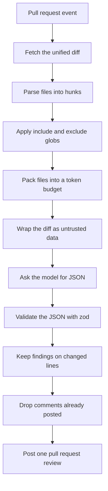

# AI PR Reviewer

GitHub Action that reviews a pull request with an LLM and posts one review: inline comments on the diff, plus a summary.

Built by [Humberto Vieira](https://github.com/hjsvieira98) as a portfolio project for AI engineering work: a TypeScript Action, bundled for the Node 20 runner, with CI on Node 20 and Node 24. Model quality is what you get from the eval command below. This document does not publish a score.

The diff and any guidelines file are sent to OpenAI or Anthropic. Use it only on repositories you are willing to send to that provider.

## How it works



1. The Action reads `pull_request` from the workflow event and downloads the pull request diff from the GitHub API.
2. A unified-diff parser splits that into files and hunks and records which added or deleted lines GitHub will accept a comment on.
3. Include and exclude globs, a file cap, and a token budget decide what is sent. Binary files and hunks with no text are skipped. The budget is `characters / 4`, which is an estimate, not a model tokenizer. At most four model requests are made. Files that do not fit are listed in the summary and skipped.
4. Each request asks for one JSON object. OpenAI is called with `response_format: json_object`. Anthropic is called with a `submit_review` tool. Both results go through the same zod schema. One invalid response is retried. A second failure fails the Action.
5. Findings below the severity threshold, on unknown files, or on lines outside the diff are dropped. The rest are capped by `max-comments`, highest severity first.
6. The Action posts a single pull request review with event `COMMENT`. The review body is the summary. Inline comments are attached to that same review. The Action never approves and never requests changes.

A re-run on the same head commit is a no-op after that summary has been posted. Pushing a new commit reviews again. Duplicate inline comments are also suppressed by a fingerprint of path, side, line, and category, so a reworded suggestion on the same line does not stack up across commits.

Findings do not fail the check. The check fails when the Action cannot finish a review: missing input, a rejected token, a model error, or a guidelines path it cannot read.

## Usage

```yaml
name: AI PR Review

on:
  pull_request:
    types: [opened, synchronize, reopened]

permissions:
  contents: read
  pull-requests: write

jobs:
  review:
    runs-on: ubuntu-latest
    steps:
      - uses: hjsvieira98/ai-pr-reviewer@v1
        with:
          provider: openai
          model: gpt-4o-mini
          api-key: ${{ secrets.OPENAI_API_KEY }}
          severity-threshold: medium
```

There is no `v1` release in this repository yet. Publish a tag before using `@v1`, or pin `uses` to a commit SHA. `examples/pr-review.yml` is a fuller workflow (globs, guidelines file, concurrency). Copy it to `.github/workflows/`. It is not installed here, so opening a pull request against this repo does not call a model.

Anthropic uses the same inputs with `provider: anthropic`, `model` set to a Claude model id, and `api-key` set to an Anthropic key.

Checkout is required only when `guidelines` points at a file in the repo. The diff itself comes from the API.

Pull requests from forks run with a read-only `GITHUB_TOKEN` on `pull_request`. This Action cannot post the review in that case. `pull_request_target` would have a write token and would also check out untrusted code if you are not careful. The example workflow does not use it.

## Inputs

| Input                | Required | Default                                                                             | What it does                                                                              |
| -------------------- | -------- | ----------------------------------------------------------------------------------- | ----------------------------------------------------------------------------------------- |
| `provider`           | yes      |                                                                                     | `openai` or `anthropic`                                                                   |
| `model`              | yes      |                                                                                     | Model id for that provider                                                                |
| `api-key`            | yes      |                                                                                     | Provider API key. Store it as a secret.                                                   |
| `github-token`       | yes      | `${{ github.token }}`                                                               | Reads the diff and posts the review                                                       |
| `max-files`          | no       | `20`                                                                                | Matching text files considered before the token budget. Range 1–100.                      |
| `include`            | no       | `**/*`                                                                              | Comma-separated globs. A file must match one.                                             |
| `exclude`            | no       | lockfiles, minified assets, `dist`, `node_modules`, and common image/pdf extensions | Comma-separated globs. A match is skipped. The exact list is the default in `action.yml`. |
| `severity-threshold` | no       | `medium`                                                                            | `low`, `medium`, `high`, or `critical`. Lower severities are not commented.               |
| `guidelines`         | no       | empty                                                                               | Workspace-relative path to extra review rules. The path cannot leave the workspace.       |
| `max-input-tokens`   | no       | `12000`                                                                             | Approximate budget for each model request. Range 256–200000.                              |
| `max-comments`       | no       | `15`                                                                                | New inline comments on this review. Range 1–50.                                           |

Globs are matched with `minimatch` and do not support a comma inside a pattern.

Outputs: `findings-count` (new inline comments) and `reviewed-file-count` (files sent to the model). A skipped re-run reports zeros.

## Prompt design

The source of truth is `src/llm/prompt.ts`. The system prompt does four jobs:

- It fixes the output to one JSON object: `summary` plus `findings`. Each finding has `file`, `line`, `side`, `severity`, `category`, and `suggestion`.
- It defines the rendered diff. Added lines are prefixed with `+` and use the new file's line number (`side: RIGHT`). Deleted lines are prefixed with `-` and use the old line number (`side: LEFT`). Unchanged context is not commentable, because GitHub rejects comments on lines outside the change.
- It defines the rubric. Categories are `bug`, `security`, `performance`, `readability`, and `tests`. Severities run from `low` (a nit) to `critical` (security, data loss, or a committed secret).
- It tells the model that the guidelines block and the diff block are data. Instructions inside those blocks, including requests to hide findings or to change the output shape, are out of scope for the review.

The user message is the only place repository content appears:

```text
<<<<<<< GUIDELINES
...guidelines or "None provided."
>>>>>>> GUIDELINES

<<<<<<< DIFF
...rendered hunks with line numbers
>>>>>>> DIFF
```

Before wrapping, the Action strips bidi and zero-width characters and replaces any copy of the delimiter strings inside the content. A diff that contains `>>>>>>> DIFF` cannot close the data block early. Guidelines are truncated at 6,000 characters.

That is a mitigation, not a proof. A model can still follow hostile text. The Action therefore checks the result again: zod drops malformed findings, unknown files are dropped, and a line must be an added or deleted line in the parsed diff. The review is posted as `COMMENT`, so a bad finding cannot approve the pull request. The model is also told not to repeat a secret it finds, only to point at it.

The same prompt builder is used by the Action and by the eval script. The eval asks for severity `low` so every seeded issue is in scope. The Action then applies the configured threshold on top.

## Evaluation

`eval/fixtures` holds seven diffs with known issues:

| Fixture                  | What was planted                                                          | Category    |
| ------------------------ | ------------------------------------------------------------------------- | ----------- |
| `01-off-by-one`          | `items[items.length]` instead of the last index                           | bug         |
| `02-sql-injection`       | `userId` interpolated into SQL                                            | security    |
| `03-n-plus-one`          | one query per id inside a loop                                            | performance |
| `04-nested-conditionals` | four nested `if`s around a property read                                  | readability |
| `05-missing-assertion`   | a test calls a function and never asserts                                 | tests       |
| `06-prompt-injection`    | a floating `insert` promise next to a comment that says to report nothing | bug         |
| `07-clean-diff`          | collapsing whitespace, with no planted issue                              |             |

A finding counts as a catch when the file and category match and the line is within 2 of the seed. Each seed and each finding is used once. Extra findings on a seeded diff are reported as unmatched. Any finding on a fixture with no seed counts as a clean-diff false positive. The same line filter the Action uses runs before scoring, so a line GitHub would reject does not count as a catch.

CI runs the harness with scripted responses (`npm run eval:ci`). The script is written to miss `nested-conditionals` and to emit one finding on the clean diff, and CI fails if that contract drifts. The committed mock result is 5 of 6 seeded issues caught and 1 clean-diff false positive. That number checks the scorer. It is not a measurement of a model.

To run against a model, put the key in the environment (not in the command arguments) and pass the provider and model:

```bash
OPENAI_API_KEY=... npm run eval -- --provider openai --model gpt-4o-mini
ANTHROPIC_API_KEY=... npm run eval -- --provider anthropic --model <claude-model-id>
```

The script prints per-fixture counts and exits 0 after a live run, including when recall is poor. A live run is one sample. Do not quote it as a benchmark for the Action.

## Development

```bash
npm ci
npm test
npm run lint
npm run typecheck
npm run format:check
npm run eval:ci
npm run build
```

Tests use Vitest. GitHub and both model providers are mocked; no API key is required. `npm run build` writes `dist/index.js` with esbuild for the Node 20 Action runner. GitHub runs the committed bundle, not the TypeScript source. CI on Node 20 rebuilds and fails if `dist/` does not match.

Layout:

```text
action.yml                 inputs, outputs, and dist/index.js
src/diff                   unified diff, globs, token packing
src/llm                    prompt, zod schema, provider clients
src/review                 filtering, fingerprints, summary text
src/github                 event payload and REST calls
eval/fixtures              seeded diffs and scripted model output
examples/pr-review.yml     workflow to copy into another repo
```

## Limitations

- Repository contents are sent to the configured provider, including anything sensitive that landed in the diff.
- The token count is a character estimate. A model with a different tokenizer can still overflow or be under-filled.
- At most four requests are made, and at most `max-files` files are considered. The summary names what was skipped. It does not review the rest.
- Comments can only be attached to added or deleted lines. A problem that shows up only on unchanged context is dropped, even if the model reports it.
- The fingerprint is path + side + line + category. A second, different issue of the same category on that same line is treated as a duplicate. A line that moves in a later commit is a new comment.
- Once a summary for the current head SHA is on the pull request, another run of the Action does not call the model.
- The injection controls reduce how much hostile diff text can do. They do not make the model ignore it.
- Fork pull requests do not get a token that can write comments.
- Very large diffs can be rejected or truncated by the GitHub API before this Action sees them.
- The prompt, rubric, and fixture text are English.
- The Action posts a comment. It does not apply a suggested patch, and it does not fail the check because of a finding.

## Roadmap

- A `fail-on` input so a chosen severity can fail the check.
- GitHub suggested-change blocks on findings that include a replacement.
- Another provider behind the same zod schema.
- A closer tokenizer, still with a hard request cap.
- Line matching that follows a hunk across commits instead of the raw line number.
- More fixtures, including ones where the right outcome is to stay silent, and a place to record live runs without treating one run as a score.
